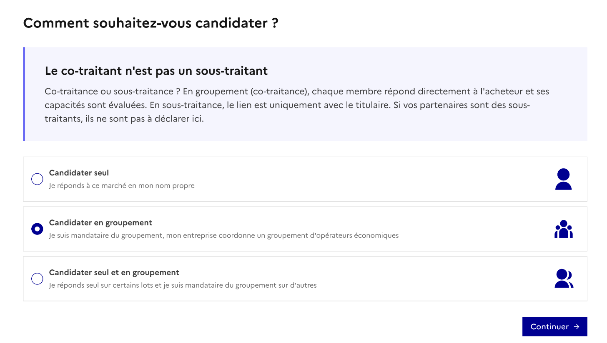
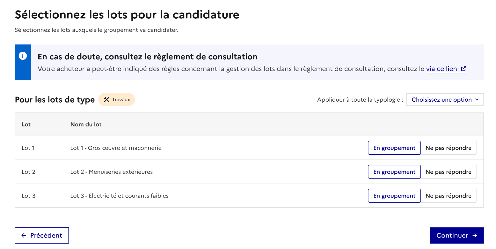
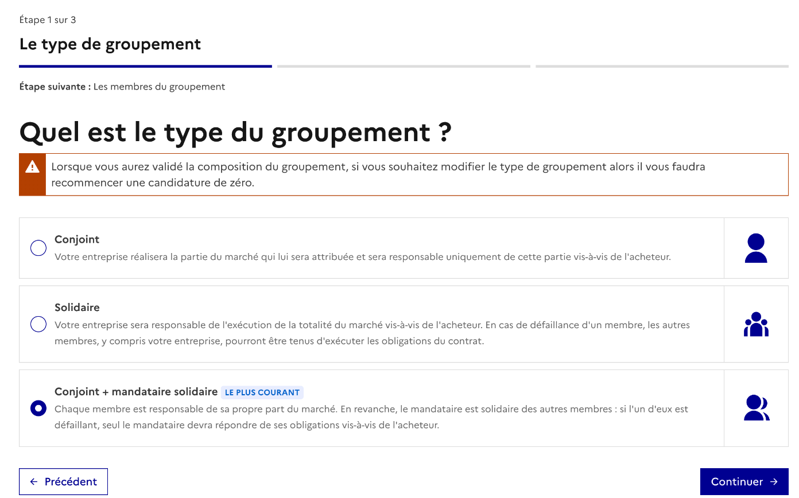
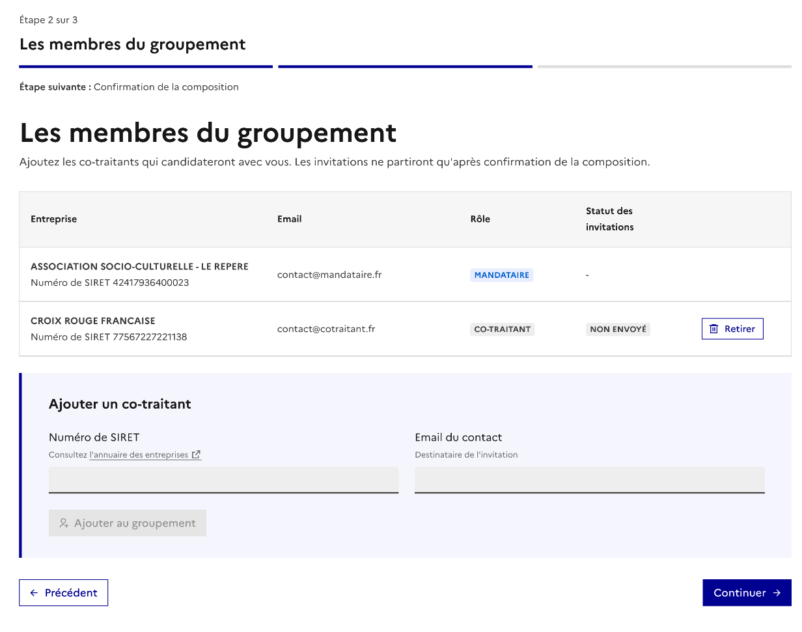
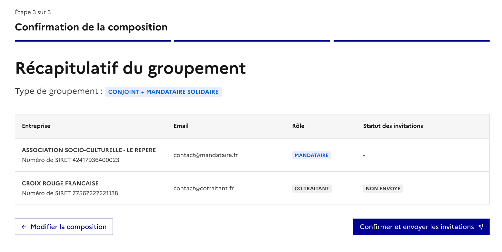
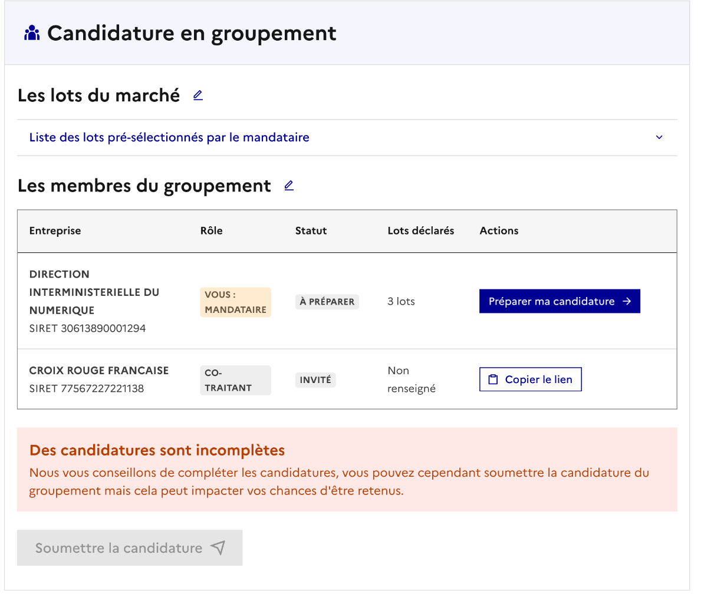
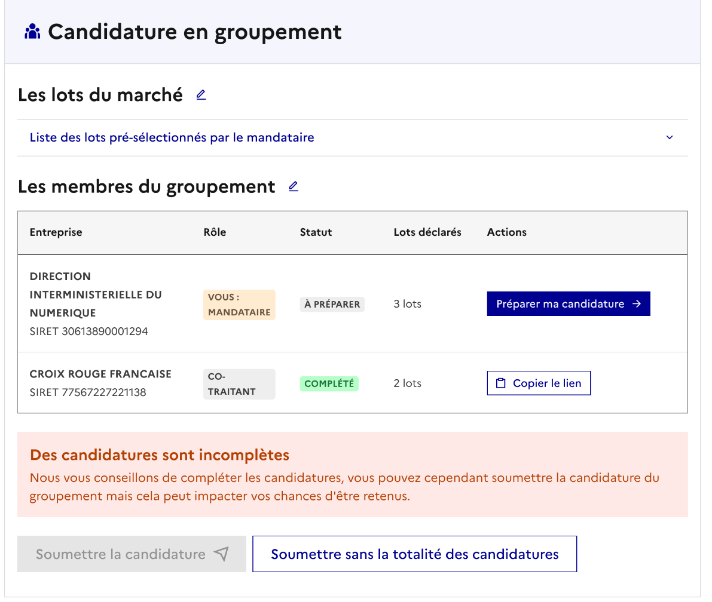
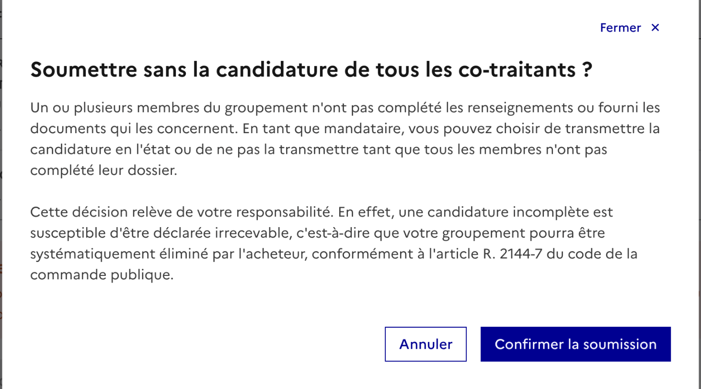
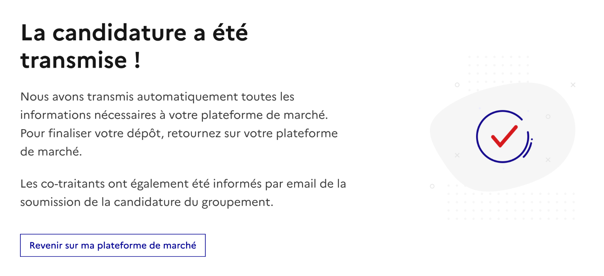

# 15. Candidater en groupement : le mandataire

Un groupement d'entreprises permet à plusieurs entreprises de répondre ensemble à un marché. L'une d'elles, le **mandataire**, représente le groupement auprès de l'acheteur et coordonne la candidature. Les autres membres sont les **co-traitants**.

Dans Passe Marché, c'est le mandataire qui crée le groupement : il choisit les lots, le type de groupement et invite ses co-traitants. Chaque membre complète ensuite sa propre partie, puis le mandataire soumet la candidature du groupement.

> 👉 Le co-traitant n'est pas un sous-traitant : en groupement, chaque membre répond directement à l'acheteur et ses capacités sont évaluées. Les sous-traitants ne sont pas à déclarer ici.

### Choisir le mode de candidature

Après votre identification, Passe Marché vous demande comment vous souhaitez candidater :

* **Candidater seul** : vous répondez au marché en votre nom propre ;
* **Candidater en groupement** : vous êtes le mandataire d'un groupement ;
* **Candidater seul et en groupement** : vous répondez seul sur certains lots et en groupement sur d'autres.

> ⚠️ Le mode choisi ne peut plus être modifié ensuite. Une même entreprise (SIRET) ne peut être mandataire que d'un seul groupement par marché.

### Sélectionner les lots du groupement

Pour chaque lot, indiquez si vous y répondez **en groupement** ou si vous **ne répondez pas**. En mode « seul et en groupement », l'option **Seul** est également proposée.

* Tous les lots sont proposés « En groupement » par défaut : il vous suffit de changer ceux qui ne sont pas concernés.
* Les lots sont regroupés par type (travaux, services, fournitures). L'option « Appliquer à toute la typologie » permet de faire le même choix pour tous les lots d'un type.
* Au moins un lot doit être « En groupement » (et, en mode « seul et en groupement », au moins un lot « Seul »).

Les lots « En groupement » constituent le **périmètre du groupement** : ce sont les seuls lots qui seront proposés à vos co-traitants.

> 👉 En cas de doute, consultez le règlement de consultation : l'acheteur y précise parfois des règles sur les lots.

### Choisir le type de groupement

Trois types de groupement sont proposés :

| Type                                                  | Ce que cela signifie                                                                                                                                                                       |
| ----------------------------------------------------- | ------------------------------------------------------------------------------------------------------------------------------------------------------------------------------------------ |
| **Conjoint**                                          | Chaque entreprise réalise la partie du marché qui lui est attribuée et n'est responsable que de cette partie vis-à-vis de l'acheteur.                                                      |
| **Solidaire**                                         | Chaque entreprise est responsable de l'exécution de la totalité du marché. En cas de défaillance d'un membre, les autres peuvent être tenus d'exécuter ses obligations.                    |
| **Conjoint + mandataire solidaire** (le plus courant) | Chaque membre est responsable de sa propre part. Le mandataire est en plus solidaire des autres membres : si l'un d'eux est défaillant, c'est le mandataire qui répond de ses obligations. |

Le type a un effet sur les co-traitants :

* en groupement **solidaire**, tous les membres sont engagés sur tous les lots du groupement : les co-traitants n'ont pas de lots à choisir ;
* en groupement **conjoint** ou **conjoint + mandataire solidaire**, chaque co-traitant choisit ses lots parmi ceux du groupement.

> ⚠️ Une fois la composition du groupement validée, le type ne peut plus être modifié : pour changer de type, il faut recommencer une candidature.

### Ajouter les co-traitants

Pour chaque co-traitant, renseignez :

* son **numéro de SIRET** (vous pouvez le retrouver dans l'annuaire des entreprises) ;
* l'**adresse e-mail** de la personne qui recevra l'invitation.

Cliquez sur « Ajouter au groupement ». Le co-traitant apparaît dans la liste avec le statut **Non envoyé**. Tant que la composition n'est pas confirmée, vous pouvez le retirer : il ne reçoit aucune notification.

Il faut au moins un co-traitant pour continuer.

> 👉 Les invitations ne partent qu'à l'étape suivante, après confirmation de la composition.

### Confirmer la composition et envoyer les invitations

Le récapitulatif reprend le type de groupement et la liste des membres. Vérifiez-les, puis cliquez sur **« Confirmer et envoyer les invitations »**.

Chaque co-traitant reçoit alors un e-mail « Vous êtes invité à rejoindre un groupement » avec un lien pour rejoindre le groupement (voir la page « Candidater en groupement : le co-traitant »).

### Suivre l'avancement du groupement

Après l'envoi des invitations, vous arrivez sur le tableau de bord **« Suivi & soumission des candidatures »**. Il regroupe :

* les informations du marché ;
* la liste des lots pré-sélectionnés pour le groupement ;
* les membres du groupement, avec leur rôle, leur statut, les lots qu'ils ont déclarés et les actions possibles.

Chaque membre a un statut :

| Statut         | Signification                                                            |
| -------------- | ------------------------------------------------------------------------ |
| **Invité**     | L'invitation a été envoyée, le co-traitant ne s'est pas encore connecté. |
| **À préparer** | Le membre s'est connecté mais n'a pas commencé son formulaire.           |
| **En cours**   | Le membre a commencé à remplir son formulaire.                           |
| **Complété**   | Le membre a terminé son formulaire et l'a transmis.                      |

Une fois la candidature du groupement soumise, tous les membres passent au statut **« Transmise »**.

epuis ce tableau de bord, vous pouvez :

* **Préparer ma candidature** : remplir votre propre formulaire, comme pour une candidature seule. Vous pouvez le sauvegarder en brouillon à chaque étape. Sur la synthèse, cliquez sur « Candidature terminée » : votre statut passe à « Complété » ;
* **Copier le lien** : copier le lien d'invitation d'un co-traitant pour le relancer ;
* **Consulter le formulaire** d'un co-traitant qui a terminé sa partie.

Vous recevez un e-mail « Un co-traitant a complété son formulaire » chaque fois qu'un co-traitant transmet sa partie.

#### Quand un co-traitant modifie sa candidature

Tant que vous n'avez pas soumis la candidature du groupement, un co-traitant qui a déjà transmis sa partie peut encore la modifier. Dès qu'il enregistre une modification, son statut repasse à **« En cours »** : vous ne pouvez plus soumettre la candidature complète tant qu'il n'a pas transmis de nouveau sa partie.

À la nouvelle transmission, son statut repasse à « Complété » et vous recevez un e-mail **« Un co-traitant a fait des modifications »**.

> 👉 Pensez à relire le formulaire du co-traitant après une modification, avant de soumettre la candidature du groupement.: tous les membres passent au statut **« Transmise »** et seul le bouton « Consulter le formulaire » reste disponible

### Soumettre la candidature du groupement

Le bouton **« Soumettre la candidature »** devient actif quand tous les membres, vous compris, sont au statut « Complété ».

Si des membres n'ont pas terminé, un encart vous le signale. Dès qu'au moins une candidature a été commencée, vous pouvez cliquer sur **« Soumettre sans la totalité des candidatures »**.

Une fenêtre vous demande alors de confirmer. Cette décision relève de votre responsabilité : une candidature incomplète peut être déclarée irrecevable par l'acheteur (article R. 2144-7 du code de la commande publique).

Après la soumission :

* un écran confirme que la candidature a été transmise à votre plateforme de marché ;
* les co-traitants sont informés par e-mail ;
* les formulaires des membres ne sont plus modifiables: tous les membres passent au statut « Transmise » et seul le bouton « Consulter le formulaire » reste disponible.

Pour finaliser votre dépôt, retournez sur votre plateforme de marché.

