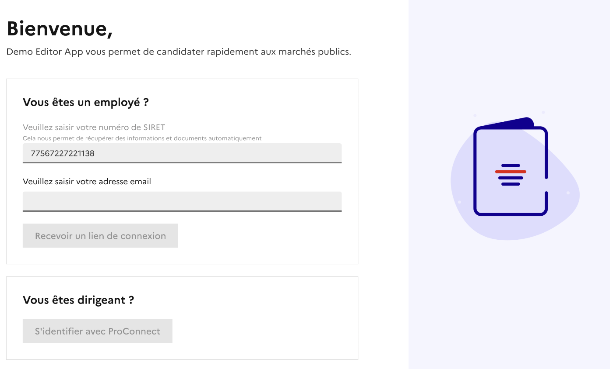
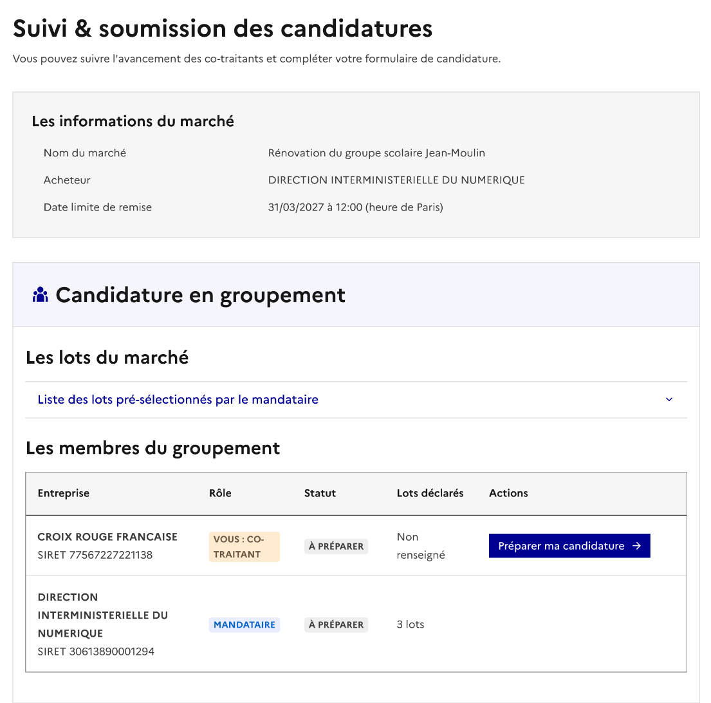
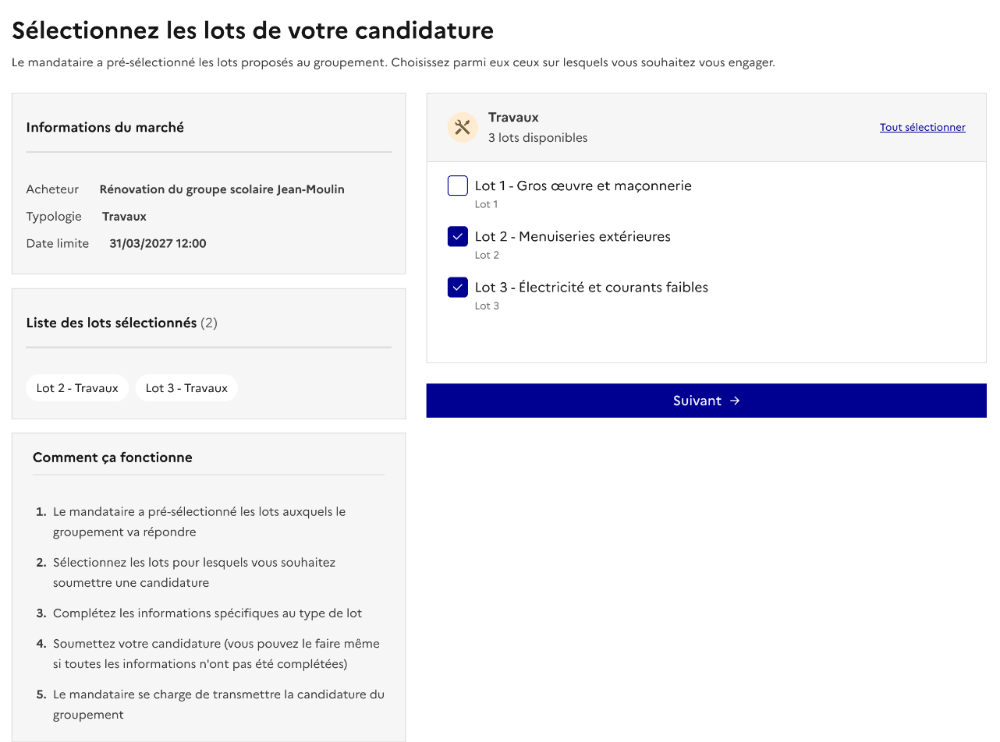
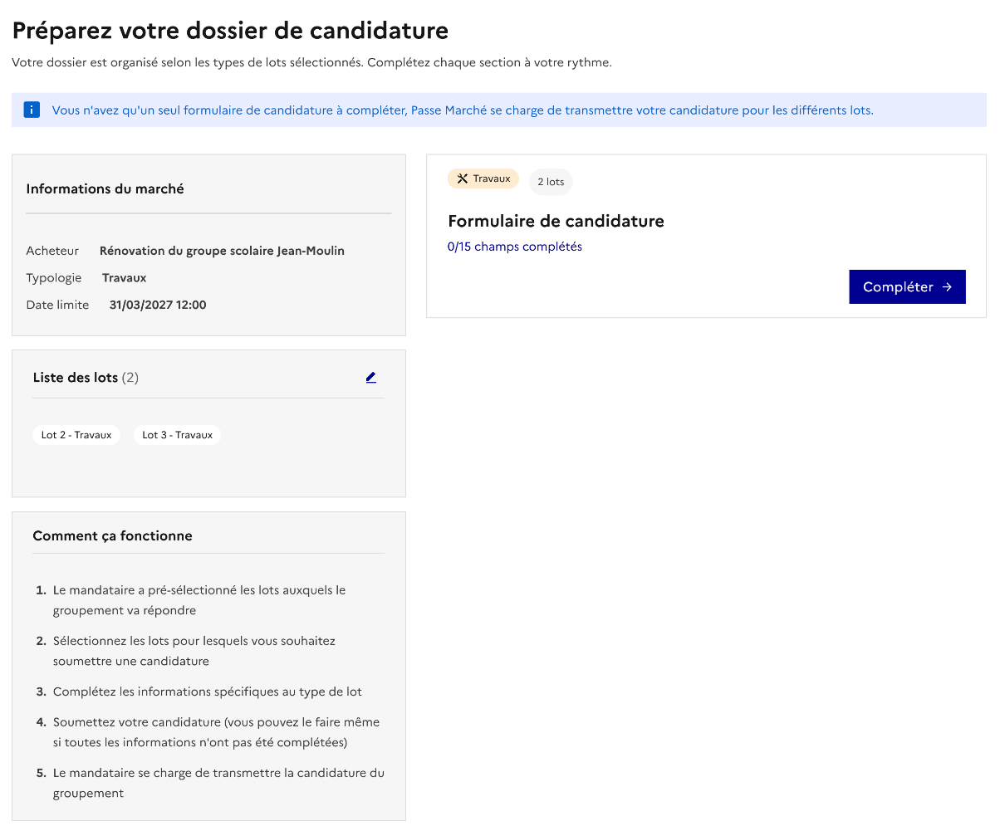
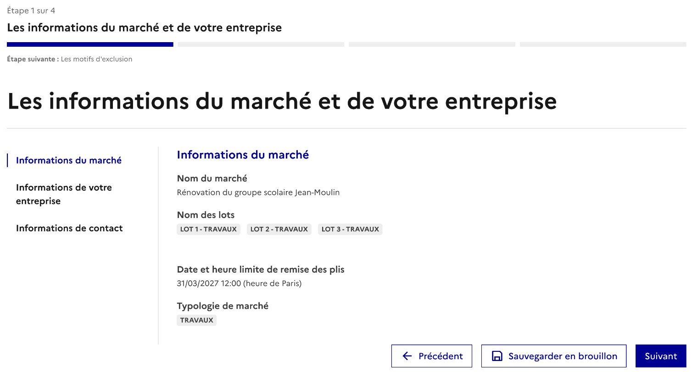
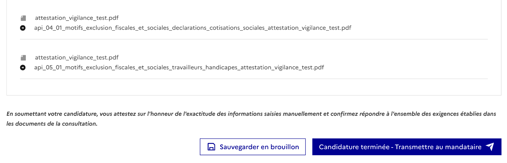
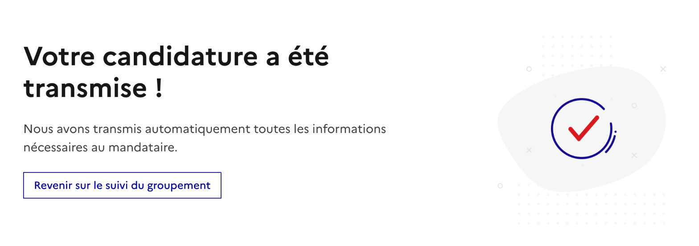
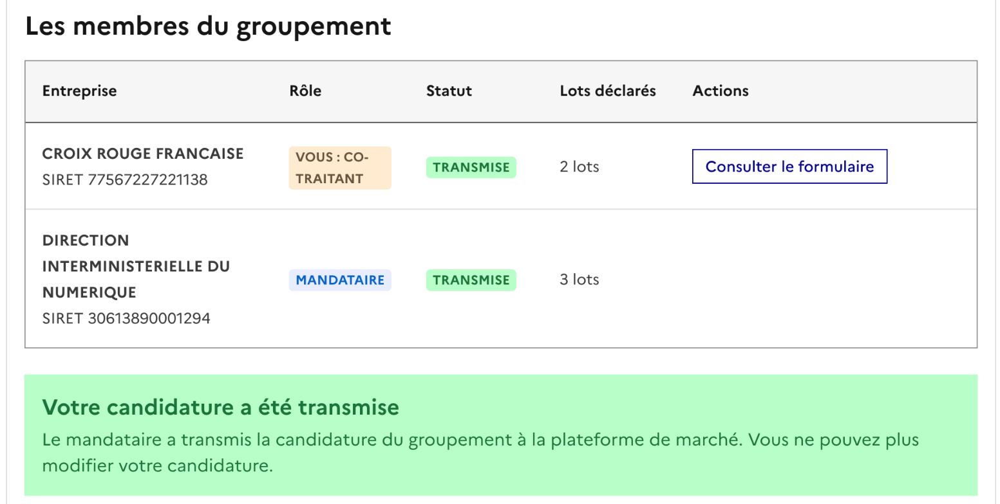
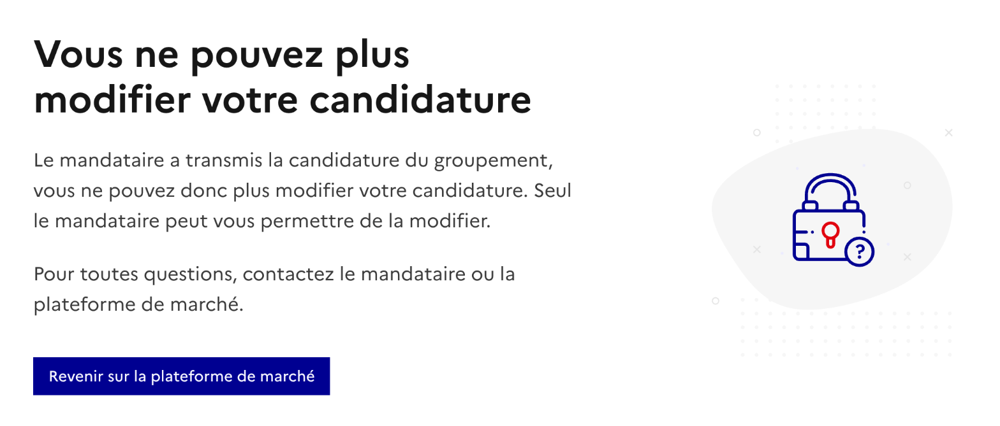

# 16. Candidater en groupement : le co-traitant

Vous êtes co-traitant quand une autre entreprise, le **mandataire**, vous invite à rejoindre le groupement qu'elle a créé dans Passe Marché. Vous complétez votre propre partie de la candidature, puis vous la transmettez au mandataire. C'est le mandataire qui soumet ensuite la candidature du groupement.

### Rejoindre le groupement

Vous recevez un e-mail **« Vous êtes invité à rejoindre un groupement »**, qui indique le nom du mandataire et le marché concerné. Cliquez sur **« Rejoindre le groupement »**.

> 👉 Si vous ne trouvez pas l'e-mail, vérifiez vos courriers indésirables ou demandez au mandataire de vous renvoyer le lien.

### S'identifier

Le numéro de SIRET de votre entreprise est déjà renseigné : c'est celui que le mandataire a indiqué, il n'est pas modifiable. Saisissez l'adresse e-mail à laquelle vous avez reçu l'invitation, puis cliquez sur « Recevoir un lien de connexion ».

Vous recevez un lien de connexion par e-mail. Il est valable 30 minutes.

### Consulter le suivi du groupement

Vous arrivez sur le tableau de bord du groupement. Votre ligne apparaît en premier, avec le badge **« Vous : co-traitant »**.

Vous y voyez :

* les informations du marché ;
* la liste des lots pré-sélectionnés par le mandataire pour le groupement ;
* les membres du groupement et leur statut. Vous ne voyez pas le contenu des candidatures des autres membres.

Cliquez sur **« Préparer ma candidature »** pour commencer.

### Déclarer vos lots

En groupement **conjoint** ou **conjoint + mandataire solidaire**, choisissez les lots sur lesquels vous vous engagez, parmi ceux pré-sélectionnés par le mandataire. Les lots choisis s'affichent au fur et à mesure dans « Liste des lots sélectionnés ». Le bouton « Suivant » s'active dès qu'un lot est coché.

> 👉 En groupement **solidaire**, cette étape n'existe pas : vous êtes engagé sur tous les lots du groupement et vous accédez directement à votre formulaire.

### Remplir votre formulaire

Votre dossier reprend les types de lots choisis. Cliquez sur « Compléter » pour ouvrir le formulaire.

Comme pour une candidature seule, les informations disponibles sont récupérées automatiquement et ne sont pas modifiables. Complétez les autres étapes à votre rythme : le bouton **« Sauvegarder en brouillon »** vous permet d'enregistrer et de reprendre plus tard.

### Transmettre votre candidature au mandataire

Sur la synthèse, vérifiez vos informations puis cliquez sur **« Candidature terminée - Transmettre au mandataire »**. Vous pouvez transmettre même si toutes les informations ne sont pas complétées.

Un écran confirme la transmission. Le mandataire est prévenu par e-mail.

### Après la transmission

Sur le suivi du groupement, votre statut passe à **« Complété »**.

#### Modifier votre candidature avant la soumission du groupement

Tant que le mandataire n'a pas soumis la candidature du groupement, et avant la date limite, vous pouvez encore modifier votre partie : cliquez sur **« Modifier ma candidature »** sur le suivi du groupement. Vous revenez à la sélection de vos lots, ou au début du formulaire si le marché n'a pas de lots.

> ⚠️ Dès que vous enregistrez une modification, votre statut repasse à « En cours » : le mandataire ne peut plus soumettre la candidature complète tant que vous n'avez pas transmis de nouveau votre partie. À la nouvelle transmission, il reçoit l'e-mail « Un co-traitant a fait des modifications ».

#### Après la soumission du groupement

Quand le mandataire a soumis la candidature du groupement :

* vous recevez un e-mail « Votre candidature a bien été prise en compte » ;
* sur le suivi, les membres passent au statut **« Transmise »** et un encart vous indique que votre candidature a été transmise ;
* seul le bouton « Consulter le formulaire » reste disponible : vous ne pouvez plus modifier votre candidature ;
* aucune attestation n'est proposée au co-traitant : l'attestation de candidature est délivrée au mandataire, pour l'ensemble du groupement.

Si vous tentez d'ouvrir votre formulaire, un écran vous indique que vous ne pouvez plus modifier votre candidature. Seul le mandataire peut vous permettre de la modifier.

